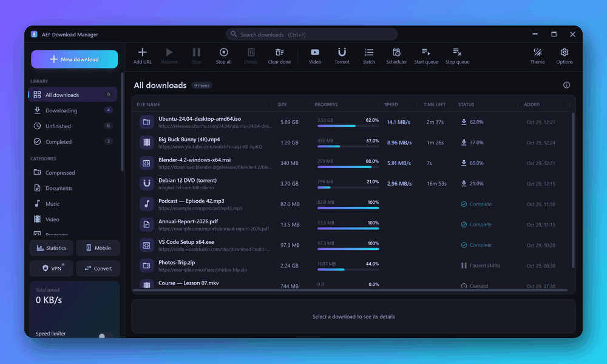
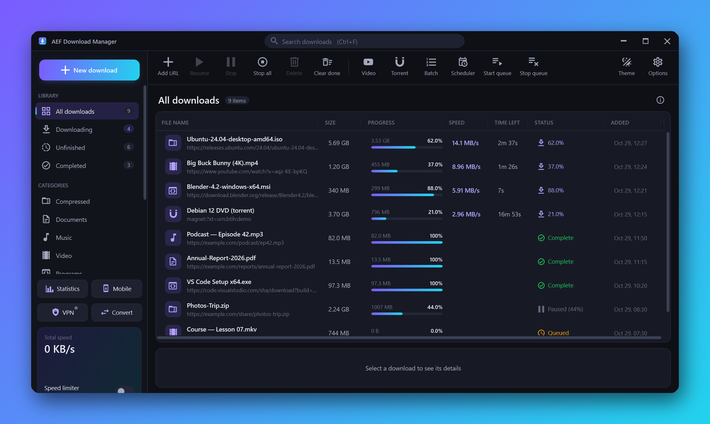
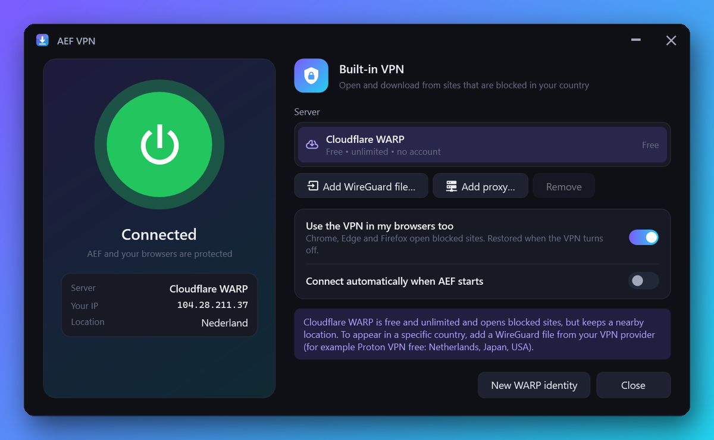
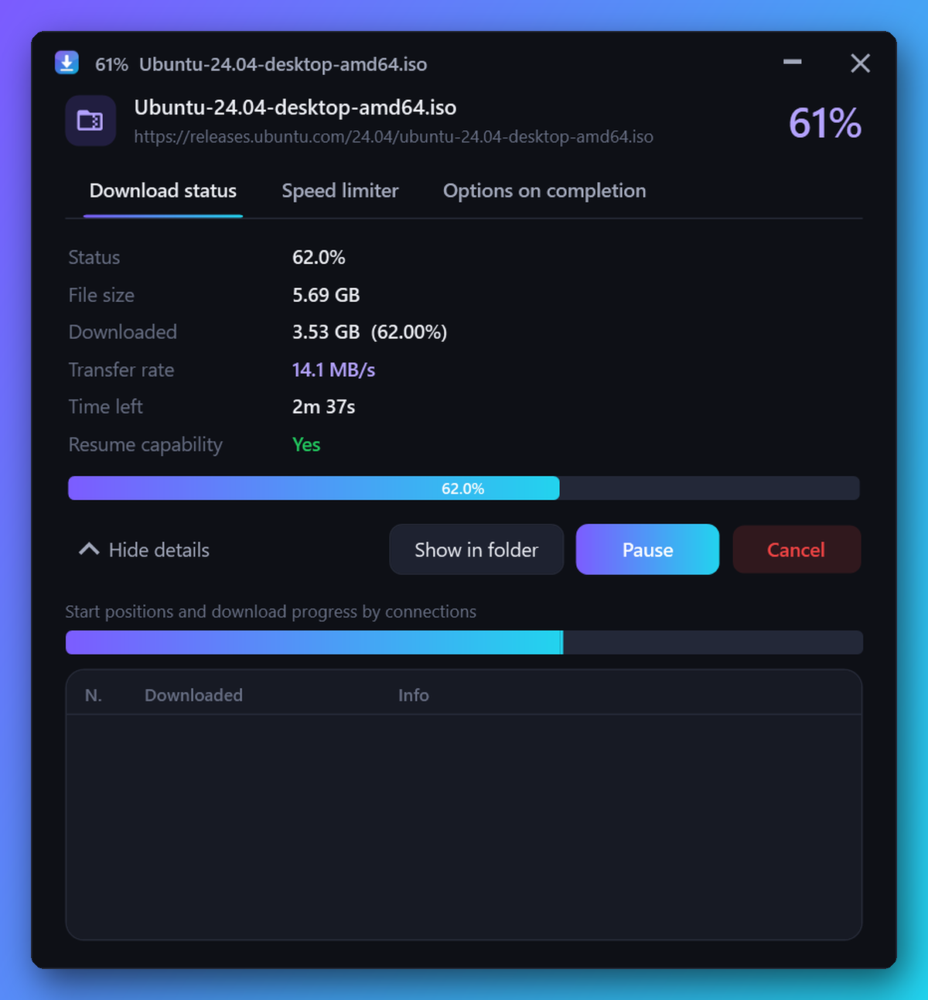
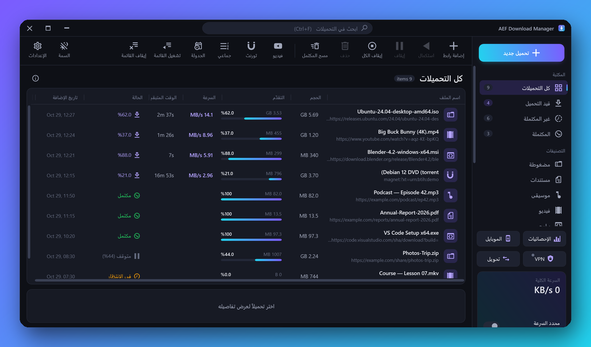
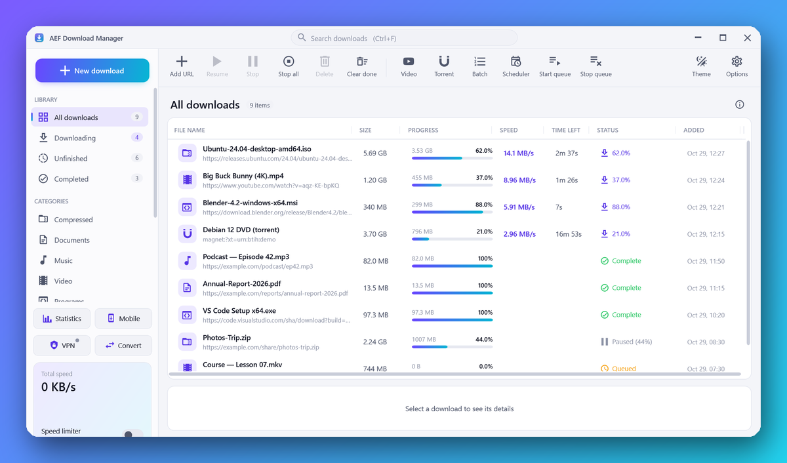
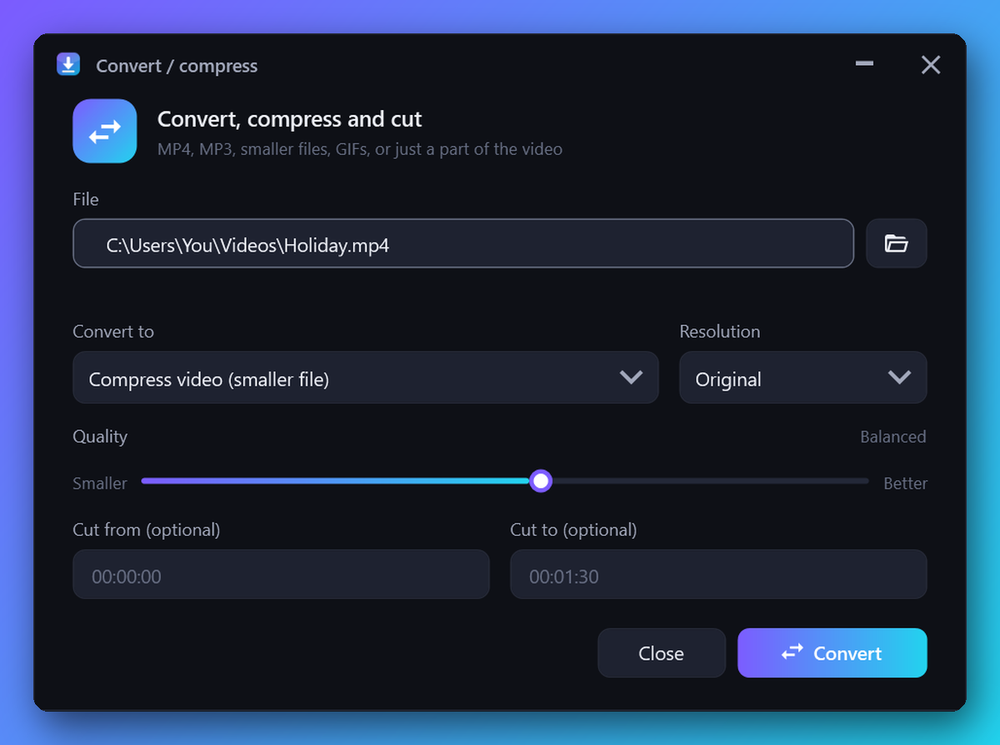
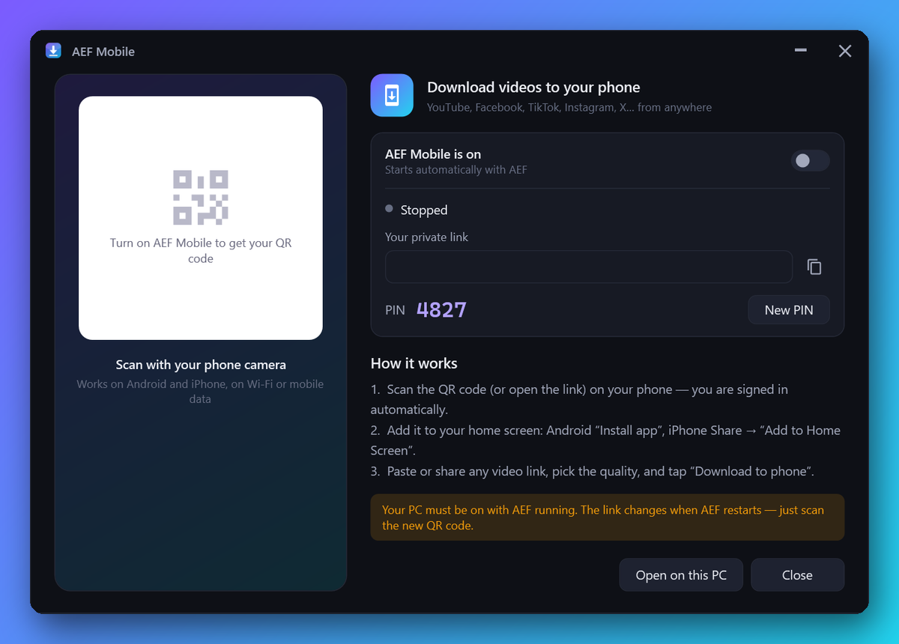
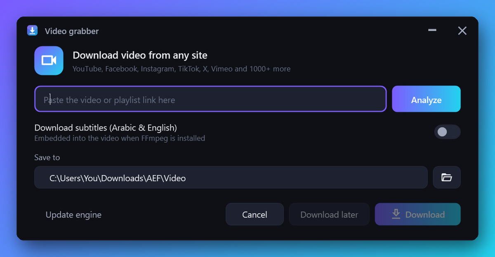
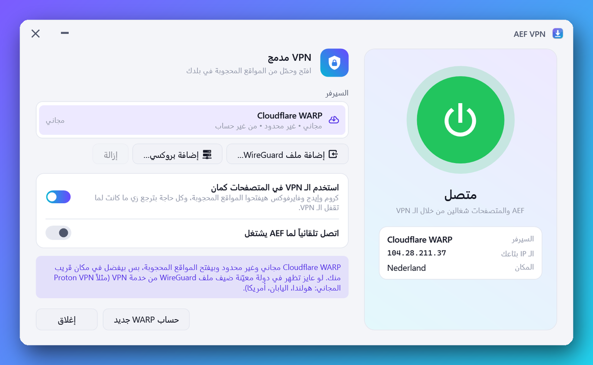

  

  
  
  
  
  

<h3 align="center">برنامج تحميل احترافي لويندوز بفكرة IDM — سريع، بواجهة عربية وإنجليزية، وبيحدّث نفسه لوحده</h3>

A professional IDM-style download manager for Windows — fast, bilingual, and self-updating.

  

  

---

## ✨ ليه AEF؟

<table>
<tr>
<td width="50%" valign="top">

### ⚡ تسريع حقيقي للتحميل
بيقسّم الملف لحد **32 اتصال** في نفس الوقت، مع تقسيم ديناميكي زي IDM. لو النت فصل بيكمّل من نفس النقطة، حتى لو قفلت الجهاز.

### 🎬 فيديو من أي موقع
يوتيوب وفيسبوك وإنستجرام وتيك توك و**+1800 موقع**، بجودة لحد **4K** أو **MP3**، وقوائم تشغيل كاملة مع الترجمة. ولو الموقع مش معروف، البرنامج بيدوّر على الفيديو جوه الصفحة نفسها.

### 🛡️ VPN مدمج
**Cloudflare WARP مجاني** بضغطة واحدة، وبيختار أسرع سيرفر لوحده. بيفتح المواقع المحجوبة للبرنامج وللمتصفح كمان، وتقدر تضيف ملف WireGuard أو بروكسي خاص بيك.

</td>
<td width="50%" valign="top">

### 🧲 تورنت وماجنت
تحميل التورنت جوه نفس البرنامج، مع اختيار الملفات اللي عايزها بس.

### 📱 AEF للموبايل
امسح كود QR من أي موبايل (أندرويد أو آيفون) وعلى أي شبكة، وابعت رابط الفيديو، والكمبيوتر يحمّله لك.

### 🎞️ تحويل وضغط وقص
MP4 و MP3 و M4A و WebM و GIF، تصغير حجم الفيديو، وقص الجزء اللي عايزه بس، كله جوه البرنامج.

### 🚫 مانع إعلانات (اختياري)
بيمنع إعلانات المواقع والنوافذ المنبثقة وأدوات التتبّع من خلال إضافة المتصفح. تشغّله أو تقفله بضغطة، وتقدر تقفله لأي موقع لوحده.

### 🔄 بيحدّث نفسه
البرنامج ومحرك الفيديو بيتحدّثوا تلقائياً، فالتحميل بيفضل شغال دايماً.

</td>
</tr>
</table>

---

## 🖼️ صور من البرنامج

  

<table>
<tr>
<td align="center"> <b>VPN مدمج</b></td>
<td align="center"> <b>نافذة تحميل لكل ملف زي IDM</b></td>
</tr>
<tr>
<td align="center"> <b>واجهة عربية كاملة</b></td>
<td align="center"> <b>ثيم فاتح وغامق</b></td>
</tr>
<tr>
<td align="center"> <b>تحويل وضغط وقص الفيديو</b></td>
<td align="center"> <b>AEF للموبايل</b></td>
</tr>
<tr>
<td align="center"> <b>تحميل الفيديو</b></td>
<td align="center"> <b>الـ VPN بالعربي</b></td>
</tr>
</table>

---

## 📦 التحميل والتثبيت

من صفحة **[Releases](../../releases/latest)** نزّل واحد من الملفات دي:

| الملف | الاستخدام |
|---|---|
| 🧩 `AEF-Download-Manager-Setup-x.y.z.exe` | **برنامج التثبيت (مستحسن):** اختصارات على سطح المكتب وقائمة ابدأ، وإزالة من لوحة التحكم |
| 💼 `AEFDownloadManager.exe` | نسخة محمولة تشتغل على طول من غير تثبيت |
| 🦊 `AEF-Firefox.xpi` | إضافة Firefox |

> [!NOTE]
> لو ظهرت رسالة **"Windows protected your PC"** اضغط **More info ← Run anyway**. الرسالة دي بتظهر لأي برنامج جديد مش موقّع رقمياً.

**المتطلبات:** Windows 10 أو 11 (64-bit). مش محتاج تثبّت أي حاجة تانية، لأن البرنامج بينزّل الأدوات اللي محتاجها لوحده.

---

## 🧩 إضافة المتصفح

<b>Chrome / Edge / Brave / Opera</b>

1. من البرنامج: **Options ← Browser integration ← Install extension** (هيفتح مجلد الإضافة).
2. في المتصفح افتح `chrome://extensions` (أو `edge://extensions`) وفعّل **Developer mode**.
3. اضغط **Load unpacked** واختار مجلد `BrowserExtension`.

بعد كل تحديث للبرنامج ادخل نفس الصفحة واضغط زرار التحديث ↻ على إضافة AEF.

<b>Firefox</b>

افتح `about:debugging#/runtime/this-firefox` ← **Load Temporary Add-on…** واختار `manifest.json` من مجلد `BrowserExtension-Firefox`.

بعد ما تركّب الإضافة، هيظهر زرار **"Download this video"** فوق أي فيديو في المتصفح، والتحميلات هتروح للبرنامج لوحدها.

---

## ❓ أسئلة شائعة

<b>الـ VPN مش بيغيّر بلدي؟</b>

WARP بيفتح المواقع المحجوبة، بس بيفضل في مكان قريب منك. لو عايز تظهر في دولة معيّنة، ضيف ملف WireGuard من خدمة VPN (مثلاً Proton VPN المجاني).

<b>فيديو مش راضي يتحمل؟</b>

شغّل الفيديو في المتصفح واضغط **"Download this video"** اللي فوقه. ولو الموقع محجوب عندك، شغّل الـ VPN من البرنامج.

<b>إزاي أحدّث البرنامج؟</b>

البرنامج بيعرض عليك التحديث لوحده. ولو حبيت تدوّر بنفسك: **Options ← Updates ← Check now**.

<b>الإعدادات بتتحفظ فين؟</b>

في `%APPDATA%\AEF Download Manager`. وتقدر تعمل نسخة احتياطية منها من **Options ← Backup & restore**.

---

## ❤️ ادعم البرنامج

AEF مجاني. لو البرنامج بيفيدك وحابب تدعم تطويره، تقدر تتبرع بأي مبلغ، وده اختياري تماماً.

  

## 🐞 الإبلاغ عن مشكلة

افتح **[Issue](../../issues/new)** واكتب المشكلة، ولو تقدر ضيف صورة. ملف الأخطاء موجود في `%APPDATA%\AEF Download Manager\error.log`.

---

   
  <b>AEF Download Manager</b> 
  تطوير <b>Amr Farahat</b> · Developed by <b>Amr Farahat</b> 
  © 2026 Amr Farahat — جميع الحقوق محفوظة · All rights reserved. الكود المصدري غير متاح للعامة.

